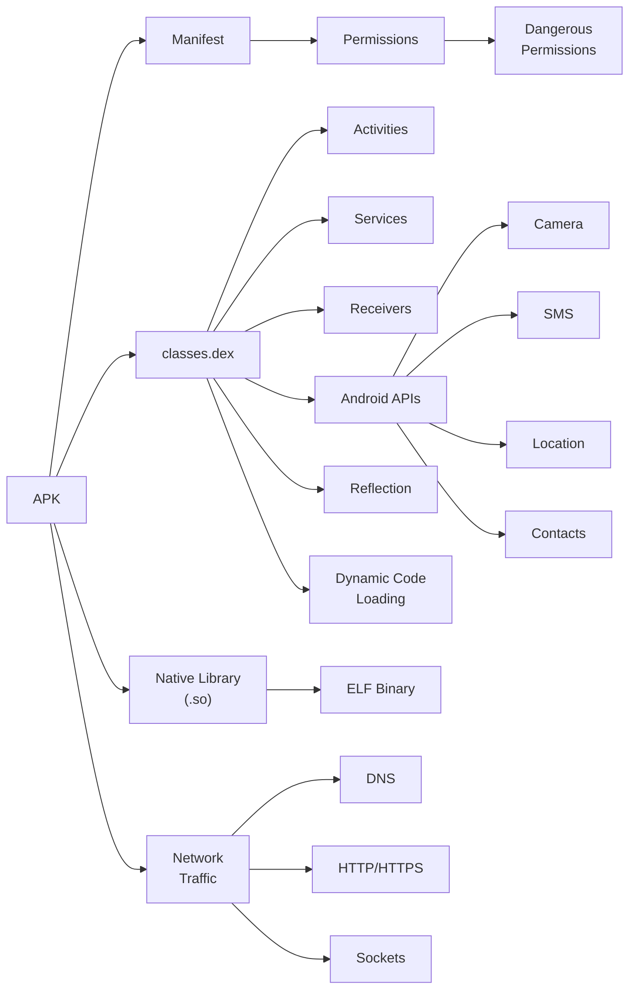

<div align="center">
    <p align="center">
        <a href="https://github.com/cybersecurity-dev/APK-Static-Toolkit">
          
        </a>
    </p>



# **`Awesome`** [APK](https://wikipedia.org/wiki/Apk_(file_format)) (_Android Package_) [Feature](https://wikipedia.org/wiki/Feature_(machine_learning)) Extractor [](https://awesome.re)
</div>

[]()
[](https://youtube.com/playlist?list=PL9V4Zu3RroiVIEtSO4i4VLlfMJqppvxvh&si=MTyY7rk1Bu5R0ncD) 
[]()

<p align="center">
    <a href="https://github.com/cybersecurity-dev/"></a>
    &nbsp;
    <a href="https://www.youtube.com/@CyberThreatDefence"></a>
    &nbsp;
    <a href="https://cyberthreatdefence.com/my_awesome_lists"></a>
    
</p>

## 📖 Contents
- [Android Reverse Engineering Tools](#android-reverse-engineering-tools)
- [My Other Awesome Lists](#my-other-awesome-lists)
- [Contributing](#contributing)
- [Contributors](#contributors)

```text
APK Feature Representations
│
├── Manifest-Based
│   ├── Permissions
│   ├── Intent Filters
│   ├── Activities
│   ├── Services
│   ├── Receivers
│   └── Providers
│
├── Code-Based
│   ├── DEX Opcodes
│   ├── API Calls
│   ├── Reflection
│   ├── Native Libraries (.so)
│   ├── Strings
│   └── Crypto APIs
│
├── Graph-Based
│   ├── Call Graph
│   ├── CFG
│   ├── ICFG
│   ├── DFG
│   ├── PDG
│   └── CPG
│
├── Sequence-Based
│   ├── Opcode Sequence
│   ├── API Sequence
│   ├── System Call Sequence
│   ├── Permission Sequence
│   └── N-Grams
│
├── Image-Based
│   ├── DEX Image
│   ├── Grayscale Image
│   ├── RGB Image
│   └── CNN Feature Maps
│
└── Dynamic Features
    ├── Network
    ├── File System
    ├── SMS
    ├── IPC
    ├── Runtime Calls
    └── System Calls
```

## Android Reverse Engineering Tools
- [APKiD](https://github.com/rednaga/APKiD) - Android Application Identifier for Packers, Protectors, Obfuscators and Oddities - PEiD for Android
- [Apktool](https://apktool.org/) - Apktool is a powerful, open-source command-line tool used for reverse engineering Android applications (_APK files_). It allows users to decode compiled Android resources and Dalvik bytecode (in _.dex_ files) back into their nearly original, human-readable forms, such as XML files for layouts and Smali code (_a low-level assembly-like language for the Dalvik Virtual Machine_).


### My Other Awesome Lists
You can access the my other awesome lists [here](https://cyberthreatdefence.com/my_awesome_lists)

### Contributing
[Contributions of any kind welcome, just follow the guidelines](contributing.md)!

### Contributors
[Thanks goes to these contributors](https://github.com/cybersecurity-dev/awesome-apk-feature-extractor/graphs/contributors)!

### License
[](http://creativecommons.org/publicdomain/zero/1.0)

[🔼 Back to top](#awesome-apk-android-package-feature-extractor-)
